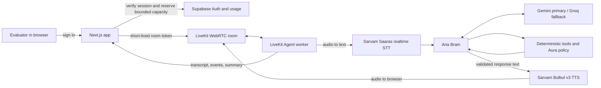

# Aria demo video and approach note

Target recording length: about 4 minutes 20 seconds. Start with the evaluator already signed in so the video spends its time on Aria rather than account setup.

## Before recording

- Confirm the latest web deployment and LiveKit `aria-voice` production worker are running.
- Sign in to the verified evaluator account and open `/call`.
- Confirm the capacity chip says **Voice available**. If it says **Text only**, **Daily demo limit reached**, or **Capacity unavailable**, stop and resolve that before recording; do not present a text-only run as a voice demo.
- Allow microphone access, use headphones, and check that the browser is using the intended microphone.
- Keep the **Test orders** panel visible. These records are fictional. Do not show `.env` files, API keys, service-role credentials, or real customer information.
- Keep the call short. The app has a five-minute call limit and a daily/IP cap; avoid repeated retries that spend provider quota.

## Timed recording script

### 0:00–0:25 — Introduce the demo

**Show:** The signed-in Aria call page.

**Say:** “This is Aria, a browser-based support assistant for the fictional Aura Skincare brand. I’ll demonstrate a live order lookup, a policy decision, and the transcript and summary generated when the call ends.”

### 0:25–1:00 — Architecture walkthrough

**Show:** The diagram in the next section of this guide, or the same flow in `docs/ARCHITECTURE.md`.

**Say:** “The browser connects through LiveKit WebRTC to a Python LiveKit Agent. Sarvam converts speech to text and Aria’s reply back to speech. The Brain uses the language model for conversation, while order and policy decisions come from deterministic tools and Aura’s configuration. Supabase handles evaluator access and bounded usage; the browser shows the transcript and post-call summary.”

### 1:00–2:15 — Look up an order

**Show:** Select **Voice**, then click **Start call**. Wait until the state indicator shows Aria is listening.

**Say to Aria:** “Hi Aria, can you check order O R D one zero one?”

Aria should read back the normalized order ID and ask you to confirm it. Say: “Yes, that’s correct.”

**Expected result:** Aria checks the order and reports that ORD-101 is **Out for Delivery**, shipped with **BlueDart**, tracking ID **BD-982103**, expected by **6 PM today**. The transcript should show the exchange and the order tool should appear in the tool list.

### 2:15–3:15 — Demonstrate a policy decision

**Say:** “Can you cancel that order? You said it’s out for delivery.”

If Aria asks you to confirm the cancellation, say: “Yes, I confirm.”

**Expected result:** Aria refuses cancellation because ORD-101 is already Out for Delivery and explains that the customer may refuse delivery at the doorstep. This is a policy refusal; no cancellation is performed.

### 3:15–3:55 — Show the post-call transcript and summary

**Show:** Click **End call** and wait for the post-call panel to appear. Scroll the chronological transcript and the structured summary into view. Briefly show the intent, order ID, resolution status, and follow-up fields. Optionally show the download buttons without opening or uploading the files.

**Say:** “The final panel keeps the conversation transcript beside a structured call summary, so an evaluator can review what Aria heard, what it did, and the reported outcome.”

**Keep the description accurate:** the current call-end summary is deterministic and local to the session; do not claim that it is an AI-written narrative or that the transcript is persisted to a database.

### 3:55–4:20 — Close

**Say:** “The key design choice is that the model speaks for the system, but it does not decide policy. The same Brain supports text fallback, while the voice providers and LiveKit session layer can be changed independently.”

## Architecture walkthrough diagram

### Plain-language talk track

1. The evaluator signs in to the Next.js app. The server checks access and available demo capacity, then issues a short-lived token for one LiveKit room.
2. The browser sends microphone audio through LiveKit to the Python worker. Sarvam STT transcribes the speech; the Brain handles the turn and can call order or policy tools; guardrails check the final answer; Sarvam TTS returns Aria’s spoken audio.
3. LiveKit manages the real-time session and audio transport. Supabase handles login and usage admission. At the end, the UI displays the transcript and a structured summary. Orders are fictional fixtures, and order-ID-only lookup is a demo shortcut, not production identity verification.

## Short approach note

Aria uses a cascaded, inspectable voice pipeline: LiveKit carries the browser session, Sarvam handles speech recognition and synthesis, and a provider-adapted language model handles conversation. Business decisions stay in deterministic tools and policy code, with output guardrails before speech; the same Brain also supports text fallback. The demo is scoped to one fictional Aura Skincare tenant, uses authenticated evaluator access, and caps usage to protect free-tier services.
